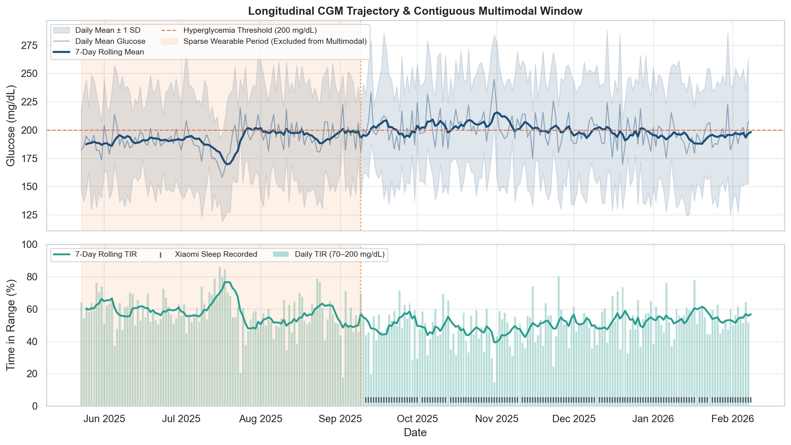
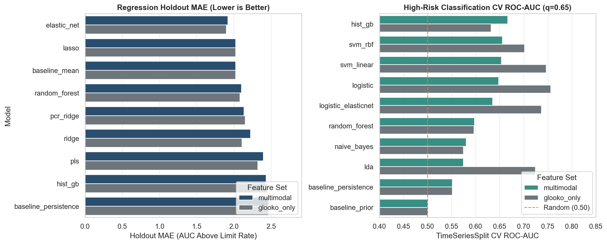
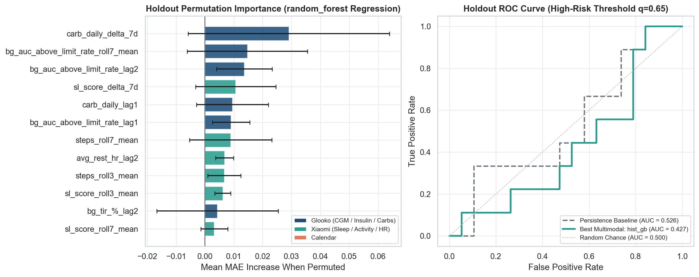

# Multimodal Glycemic Analysis

An end-to-end longitudinal data science pipeline that integrates **continuous glucose monitoring (CGM), insulin, and carbohydrate logs (Glooko)** with **wearable sleep, heart-rate, activity, and workout telemetry (Xiaomi MiFitness)** to analyze and forecast daily hyperglycemic risk.

---

## Key Highlights

- **Multimodal ETL on real-world health exports**: Parses heterogeneous vendor CSVs and nested JSON payloads, normalizes timezones (`Europe/Rome`), computes time-weighted CGM metrics (`mean`, `SD`, `CV`, `TIR`, `TAR`, hyperglycemic `AUC rate`), and filters insulin correction boluses from meal carbohydrates.
- **Contiguous multimodal window detection**: Automatically identifies and excludes a 3-month summer wearable recording gap (`Jun–Aug 2025`), preserving >93% wearable and sleep feature availability across the continuous multimodal overlap (`2025-09-09` → `2026-02-07`, 149 modeling days).
- **Strict leak-free temporal feature engineering**: Builds 68 predictors using only past information (`t-1`, `t-2` lags, shifted 3-day/7-day rolling statistics, acute 7-day baseline deltas, sleep missingness flags, and cyclical day-of-week features), verified by automated anti-leakage unit tests.
- **Rigorous time-aware benchmarking & ablation**: Evaluates regression (`R²`, `MAE`, `RMSE`) and binary high-risk classification (`ROC-AUC`, `PR-AUC`, `Brier`) with `TimeSeriesSplit` CV and a 28-day chronological holdout against explicit **Mean/Prior** and **Persistence (`y_{t-1}`)** baselines, plus a controlled **Glooko-only vs. Multimodal** ablation study.
- **Interpretability & automated reporting**: Exports holdout permutation importance and generates 4 publication-ready figures via a single CLI command.

---

## Longitudinal Overview & Multimodal Window



The raw merged timeline spans **262 days** (`2025-05-23` → `2026-02-08`), but Xiaomi wearable recording was sparse during summer 2025 before becoming continuous in September 2025. Restricting modeling to the contiguous multimodal window prevents wearable features from being silently dropped by availability filters and ensures fair comparison between `glooko_only` (41 features) and `multimodal` (68 features) models.

---

## Exploratory Signal: Lagged Predictors vs. Next-Day Outcomes


Notable next-day Spearman associations on the contiguous multimodal window:
- **Previous-day carbohydrates (`carb_daily_lag1`)** correlate positively with next-day hyperglycemic AUC rate (`ρ = +0.23`).
- **7-day rolling step volume (`steps_roll7_mean`)** correlates negatively with glucose variability (`ρ = -0.22`), while previous-day bolus insulin (`ins_bolo_tot_lag1`) correlates positively with Time in Range (`ρ = +0.22`).
- **Weekend indicator (`cal_is_weekend`)** shows elevated glucose variability (`ρ = +0.19`) and hyperglycemic AUC rate (`ρ = +0.14`).

---

## Modeling Strategy & Benchmark Results

All models are evaluated on the **contiguous multimodal window** (`121` training days, `28` chronological holdout days, target = `bg_auc_above_limit_rate`) using `TimeSeriesSplit` (5 folds) for hyperparameter tuning.

### 1. Regression Benchmark (Multimodal — 68 features)

| Model | CV R² | Holdout R² | CV MAE | Holdout MAE | Holdout RMSE |
| :--- | :---: | :---: | :---: | :---: | :---: |
| **Elastic Net** | -0.026 | **-0.045** | 2.342 | **1.918** | **2.400** |
| **Random Forest** | **-0.003** | -0.259 | **2.291** | 2.100 | 2.635 |
| Lasso | -0.059 | -0.072 | 2.416 | 2.022 | 2.431 |
| Ridge | -0.010 | -0.398 | 2.327 | 2.221 | 2.776 |
| PCR + Ridge | -0.036 | -0.201 | 2.412 | 2.135 | 2.573 |
| *Baseline: Mean* | -0.065 | -0.072 | 2.420 | 2.022 | 2.431 |
| *Baseline: Persistence (`y_{t-1}`)* | -1.072 | -0.805 | 3.373 | 2.466 | 3.155 |

### 2. High-Risk Classification & Modality Ablation (`q = 0.65`, cutoff = `11.35`)

| Model | Multimodal CV AUC | Glooko-Only CV AUC | Multimodal Holdout AUC | Multimodal Holdout PR-AUC |
| :--- | :---: | :---: | :---: | :---: |
| **HistGradientBoosting** | **0.667** | 0.632 | 0.427 | 0.325 |
| **SVM (RBF)** | 0.656 | 0.702 | **0.509** | **0.450** |
| SVM (Linear) | 0.653 | 0.746 | 0.439 | 0.339 |
| Logistic Regression | 0.648 | **0.756** | 0.427 | 0.417 |
| Logistic Elastic Net | 0.635 | 0.737 | 0.439 | 0.365 |
| *Baseline: Persistence* | 0.551 | 0.551 | 0.526 | 0.385 |
| *Baseline: Prior* | 0.500 | 0.500 | 0.500 | 0.321 |



### Key Scientific Takeaways

1. **Modest but real signal under high daily noise**: Strongly regularized models (`Elastic Net` in regression: `1.918` vs `2.022` mean baseline MAE; `HistGradientBoosting` and `SVM-RBF` in CV classification: `0.667` / `0.656` vs `0.551` persistence AUC) outperform naive baselines in cross-validation, while unregularized/flexible models overfit.
2. **Curse of dimensionality in small-N multimodal learning**: Adding 27 wearable features (41 → 68) helps tree-based classification (`HistGB` CV AUC `0.632` → `0.667`) and surfaces sleep/activity predictors in permutation importance, whereas linear classifiers perform stronger in CV with the leaner `glooko_only` set (`Logistic` CV AUC `0.756`) due to `n_train = 121`.
3. **Non-stationarity on the final 28-day holdout**: Holdout classification AUC drops toward baseline despite strong CV AUC, reflecting physiological and behavioral drift across winter months — motivating rolling retraining and intraday (post-prandial) modeling as next steps.

---

## Interpretability & Holdout ROC



Holdout permutation importance on the multimodal `Random Forest` highlights both **Glooko** (`carb_daily_delta_7d`, `bg_auc_above_limit_rate_roll7_mean`, `bg_auc_above_limit_rate_lag2`) and **Xiaomi** (`sl_score_delta_7d`, `steps_roll7_mean`, `avg_rest_hr_lag2`, `sl_score_roll3_mean`) signals among the top contributors.

---

## Architecture & Project Structure

```text
Multimodal_glicemic_analysis/
├── multimodal_glycemic_analysis/
│   ├── Data/
│   │   ├── glooko/                         # Raw CGM, insulin, bolus, and alarm exports
│   │   ├── xiaomi/                         # Raw MiFitness daily aggregates and sport records
│   │   └── processed/                      # Cleaned parquet tables, ML benchmarks, ablation & importance CSVs
│   └── Scripts/
│       ├── config.py                       # Centralized paths, feature groups, and defaults
│       ├── GlookoDataCleaning.py           # Time-weighted CGM stats, insulin & meal-carb ETL
│       ├── XiaomiDataCleaning.py           # JSON payload unpacking for HR, sleep, steps & workouts
│       ├── MergeData.py                    # Daily index alignment and outer join
│       ├── Processing_and_descriptive.py   # Contiguous window detection, lags, rolling windows & calendar features
│       ├── MLapplications.py               # TimeSeriesSplit benchmarks, baselines, ablation & permutation importance
│       ├── Visualizations.py               # Automated report figure generation
│       └── pipeline.py                     # Unified CLI orchestrator
├── reports/
│   └── figures/                            # Generated PNG visualizations
├── tests/
│   └── test_pipeline.py                    # Unit tests (ETL math, gap trimming, anti-leakage, ablation)
├── requirements.txt
└── README.md
```

---

## Setup & Usage

```bash
python -m venv .venv
.venv\Scripts\activate      # Windows
# source .venv/bin/activate # Linux / macOS
pip install -r requirements.txt
```

### Run the full pipeline (ETL → Features → Benchmark & Ablation → Figures)

```bash
python multimodal_glycemic_analysis/Scripts/pipeline.py all
```

### Run individual stages

```bash
python multimodal_glycemic_analysis/Scripts/pipeline.py clean
python multimodal_glycemic_analysis/Scripts/pipeline.py features --lag-days 2
python multimodal_glycemic_analysis/Scripts/pipeline.py train --task all --holdout-days 28
python multimodal_glycemic_analysis/Scripts/pipeline.py report
```

### Run automated tests

```bash
python -m unittest discover -s tests -v
```

---

## Limitations & Next Steps

- **Sample size (`n = 149` contiguous multimodal days, single subject)**: Limits complex nonlinear models and increases variance on a single 28-day chronological holdout.
- **Daily aggregation**: Compresses sub-daily post-prandial and overnight glycemic excursions into daily summaries.
- **Next steps**: Intraday post-prandial window modeling (2–4h post-meal CGM response), nested expanding-window backtesting, and probabilistic calibration.
