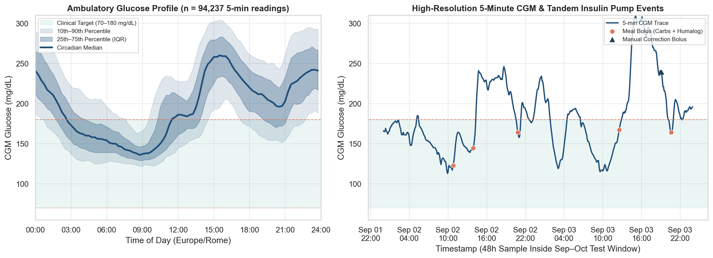
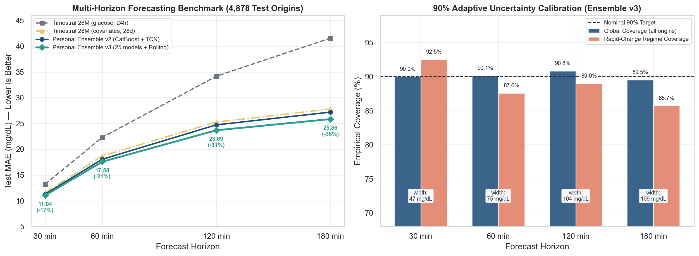
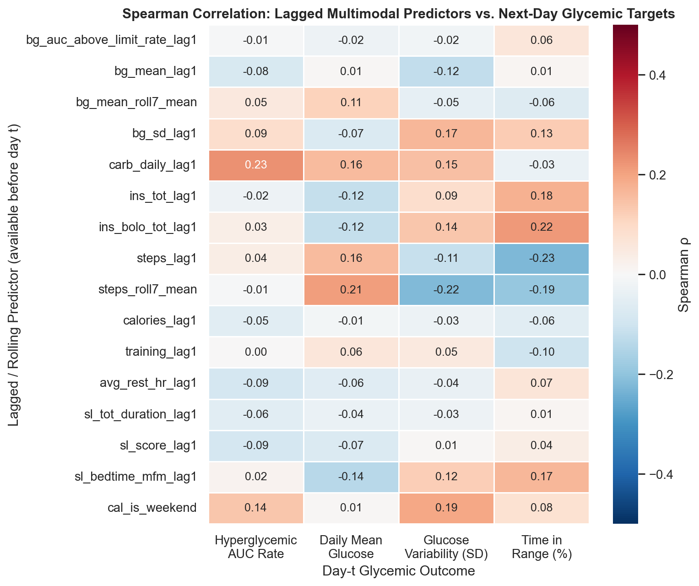

# Multimodal Glycemic Analysis & High-Resolution CGM Forecasting

An end-to-end longitudinal health data science and deep learning repository combining **two complementary modeling tracks** on real-world personal diabetes telemetry:

1. **Track A — High-Resolution Intraday CGM Forecasting (`intraday_forecasting/`)**:
   - **94,237** 5-minute CGM + Tandem insulin pump readings (`Nov 2025 – Oct 2026`) and **207 engineered features** (Humalog IOB pharmacological curves, causal `(t-5min, t]` grid, meal vs. correction bolus disambiguation).
   - **Mistral Timestral 28M/209M** foundation model fine-tuning (head + last decoder block), **PyTorch causal trajectory / TCN networks**, **CatBoost** residual correctors, weekly prequential rolling refits, and a **25-candidate convex ensemble**.
   - **Adaptive regime-conditioned 90% prediction intervals** achieving **89.5%–90.8%** empirical coverage across 30/60/120/180-minute horizons, reducing 3-hour MAE by **37.8%** (`41.57 → 25.86 mg/dL`).
   - Audited by **63 automated tests**, SHA-256 data/code manifests, frozen pre-scoring selection (`selection-frozen.json`), memory-mapped dataset building (<500 MiB RAM), and CPU/CUDA parity verification (`max diff 0.000015 mg/dL`).

2. **Track B — Daily Multimodal Glycemic Risk Analysis (`multimodal_glycemic_analysis/`)**:
   - Integrates **Glooko** (CGM, insulin, meal carbs) with **Xiaomi MiFitness wearable** telemetry (sleep structure/score/bedtime, steps, resting HR, calories, workouts).
   - Automatic detection of the contiguous multimodal recording window (`Sep 2025 – Feb 2026`, `n = 149` days with >93% wearable availability), strict leak-free lagged/rolling/calendar feature engineering (68 predictors), controlled **Glooko-only vs. Multimodal** ablation, and holdout permutation importance (**7 automated tests**).

> *Research & portfolio project only — local training and historical replay; not a medical device and never used for dosing or pump control.*

---

## Track A: High-Resolution 5-Minute CGM Forecasting (`intraday_forecasting/`)

### Ambulatory Glucose Profile & High-Resolution Pump Telemetry



### Multi-Horizon Benchmark & 90% Adaptive Uncertainty Calibration (`4,878` Sep–Oct Test Origins)

| Model | 30 min MAE | 60 min MAE | 120 min MAE | 180 min MAE | Notes |
| :--- | :---: | :---: | :---: | :---: | :--- |
| **Personal Ensemble v3** | **11.04** | **17.58** | **23.69** | **25.86** | 25-candidate convex ensemble + weekly rolling refits |
| Personal Ensemble v2 | 11.30 | 18.06 | 24.74 | 27.21 | Static CatBoost + TCN + frozen Timestral corrector |
| Timestral 28M (covariates, 28d) | 11.57 | 18.71 | 25.29 | 27.82 | Pretrained foundation model with long context + covariates |
| Timestral 28M (glucose, 24h) | 13.23 | 22.31 | 34.18 | 41.57 | Baseline 24-hour glucose-only foundation model |

*MAE in `mg/dL`. Ensemble v3 cuts 3-hour MAE by **37.8%** vs. the 24h baseline and **2–5%** vs. v2.*

- **Timestral Fine-Tuning**: Updating the prediction head (`1.88M` params, glucose/24h) reduced 3h validation MAE from `41.79 → 37.57 mg/dL`; updating head + last decoder block (`4.54M` params, covariates/72h) reduced 3h validation MAE from `31.13 → 29.19 mg/dL`.
- **Adaptive 90% Uncertainty Intervals (`adaptive_group`)**:
  - **Global coverage**: **89.99% / 90.13% / 90.84% / 89.51%** (30 / 60 / 120 / 180 min)
  - **Mean width**: **46.70 / 74.86 / 104.26 / 108.51 mg/dL** (tighter than v2 on all 4 horizons)
  - **Rapid-change regime coverage**: **92.51% / 87.57% / 89.01% / 85.71%** (improving 60-min rapid-change coverage from `81.1%` in v2 to `87.6%` in v3)



Full experimental protocol, frozen manifests, and verification logs are documented in [`intraday_forecasting/RESUME.md`](intraday_forecasting/RESUME.md) and [`intraday_forecasting/README.md`](intraday_forecasting/README.md).

---

## Track B: Daily Multimodal Analysis — Glooko + Xiaomi Wearable (`multimodal_glycemic_analysis/`)

### Longitudinal Overview & Contiguous Multimodal Window


The raw merged timeline spans **262 days** (`2025-05-23` → `2026-02-08`), with sparse wearable coverage during summer 2025. Automatic contiguous window detection restricts multimodal modeling to `2025-09-09` → `2026-02-07` (`121` training + `28` chronological holdout days), preserving >93% sleep and activity feature availability and enabling a fair **Glooko-only (41 features) vs. Multimodal (68 features)** ablation.

### Exploratory Signal: Lagged Predictors vs. Next-Day Outcomes



### Daily Benchmark, Modality Ablation & Permutation Importance

| Task / Model | Multimodal CV | Glooko-Only CV | Multimodal Holdout | Baseline Reference |
| :--- | :---: | :---: | :---: | :--- |
| **Regression — Elastic Net** (`MAE`) | 2.342 | 2.299 | **1.918** (`RMSE 2.400`) | Mean baseline `2.022` · Persistence `2.466` |
| **Regression — Random Forest** (`MAE`) | **2.291** | 2.287 | 2.100 (`RMSE 2.635`) | Mean baseline `2.022` · Persistence `2.466` |
| **High-Risk Clf (`q=0.65`) — HistGB** (`ROC-AUC`) | **0.667** | 0.632 | 0.427 (`PR 0.325`) | Persistence CV `0.551` · Prior `0.500` |
| **High-Risk Clf (`q=0.65`) — SVM RBF** (`ROC-AUC`) | 0.656 | 0.702 | **0.509** (`PR 0.450`) | Persistence CV `0.551` · Prior `0.500` |
| **High-Risk Clf (`q=0.65`) — Logistic** (`ROC-AUC`) | 0.648 | **0.756** | 0.427 (`PR 0.417`) | Persistence CV `0.551` · Prior `0.500` |


### Cross-Track Scientific Takeaways

1. **Resolution drives predictability**: Moving from daily aggregates (`n = 149` days, modest regression edge over mean baseline) to causal 5-minute intraday telemetry (`n = 94,237` readings, 207 pharmacological/physiological features) unlocks dramatic forecasting accuracy (`11.04 mg/dL` at 30 min; `-37.8%` MAE at 3h) and well-calibrated 90% uncertainty bands.
2. **Multimodal wearables vs. small-N dimensionality**: On daily aggregation, wearable sleep/activity signals (`sl_score_delta_7d`, `steps_roll7_mean`, `avg_rest_hr_lag2`) rank among the top Random Forest permutation importances and boost tree-based classification (`HistGB` CV AUC `0.632 → 0.667`), whereas linear models favor the leaner `glooko_only` set under `n_train = 121`.
3. **Evaluation rigor**: Both tracks enforce strict chronological splits, explicit naive baselines, and automated anti-leakage tests (70 tests total across both tracks).

---

## Repository Structure

```text
Multimodal_glicemic_analysis/
├── intraday_forecasting/                   # Track A: 5-min CGM + Tandem pump forecasting (TimestralGluco v1-v3)
│   ├── config/                             # Experiment & resource configs (v1, v2, v3)
│   ├── data/                               # 94,237 cleaned 5-min CGM/Basal/Bolus rows & Tandem exports
│   ├── scripts/                            # Staged CPU/CUDA runners, artifact verification & portfolio figure script
│   ├── src/                                # Causal ETL, Humalog IOB curves, Timestral, CatBoost, TCN & v3 ensemble
│   ├── tests/                              # 63 automated unit tests (causality, memory-mapping, uncertainty, v3)
│   ├── RESUME.md                           # Audited v2 & v3 experiment results and verification log
│   ├── requirements.txt                    # Full PyTorch + CatBoost + Mistral Timestral dependencies
│   └── README.md                           # Detailed intraday training & CUDA/WSL runbook
├── multimodal_glycemic_analysis/           # Track B: Daily multimodal Glooko + Xiaomi wearable pipeline
│   ├── Data/                               # Raw Glooko & Xiaomi exports + processed parquet/CSV artifacts
│   └── Scripts/                            # ETL, contiguous window detection, feature engineering, ML & visualizations
├── reports/
│   └── figures/                            # 6 publication-ready PNG figures (Track A + Track B)
├── tests/
│   └── test_pipeline.py                    # Track B unit tests (7 tests: ETL math, gap trimming, anti-leakage, ablation)
├── requirements.txt                        # Core lightweight dependencies (Track B + figure generation)
└── README.md
```

---

## Setup & Usage

### Track B — Daily Multimodal Pipeline (Fast, CPU)

```bash
python -m venv .venv
.venv\Scripts\activate      # Windows
# source .venv/bin/activate # Linux / macOS
pip install -r requirements.txt

# Run full Track B pipeline (ETL -> Features -> Benchmark & Ablation -> Figures)
python multimodal_glycemic_analysis/Scripts/pipeline.py all

# Run Track B unit tests
python -m unittest discover -s tests -v
```

### Track A — High-Resolution 5-Minute Intraday Forecasting

```bash
cd intraday_forecasting
pip install -r requirements.txt

# Regenerate Track A portfolio figures from cleaned 5-min CGM & pump data
python scripts/generate_portfolio_figures.py

# Run Track A automated unit tests (causality, personal rules, memory-mapped IOB, v3)
python -m unittest discover -s tests -v

# Full staged v3 training & verification (requires Mistral Timestral weights + PyTorch/CatBoost)
python scripts/run_v3.py all
```
